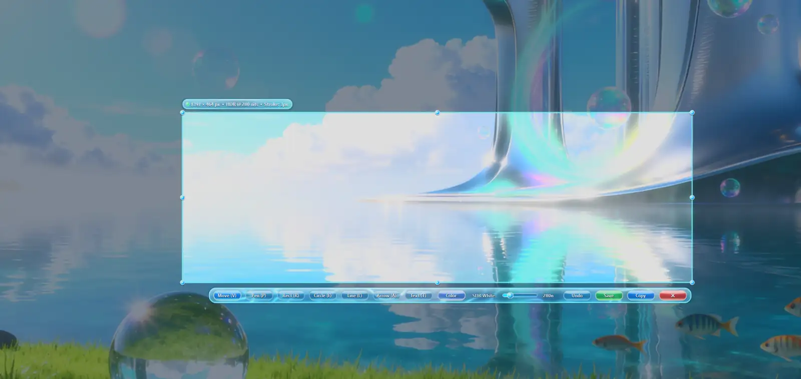
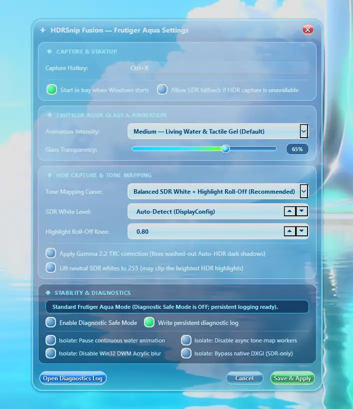

# HDRSnip Fusion · HDR Screenshot Tool for Windows

**Free, open-source Windows screenshot and annotation tool with HDR and Auto HDR capture, a global hotkey, and a Frutiger Aqua-inspired interface.**

[**⬇ Download for Windows (v0.1.2)**](https://github.com/shadow728270/HDRScreenshot-FrutigerAqua/releases/latest/download/HDRSnipFusion.exe) · [Releases](https://github.com/shadow728270/HDRScreenshot-FrutigerAqua/releases) · [Project website](https://shadow728270.github.io/HDRScreenshot-FrutigerAqua/) · [Report an issue](https://github.com/shadow728270/HDRScreenshot-FrutigerAqua/issues)

**Windows 10 / 11 · 64-bit · MIT licensed · No Python required for the EXE**

HDRSnip Fusion is designed for people who want to capture a selected area of their Windows screen, including HDR or Windows Auto HDR content, without relying solely on an ordinary SDR screen grab. It captures through **DXGI Desktop Duplication**, maps HDR screen data for viewable PNG output, and provides a lightweight screenshot editor and tray hotkey.

## Screenshots

### HDR screenshot selection and annotation



*HDR-aware region selection with the translucent Aqua toolbar, annotation controls, and a draggable selection frame.*

### Frutiger Aqua Settings



*Settings for capture, liquid-glass animation, HDR tone mapping, and diagnostics. This example shows a user-configured `Ctrl+X` shortcut; **the built-in default for new installations is `Ctrl+Shift+X`**.*

## Features

- **HDR-aware screenshots:** DXGI Desktop Duplication with scRGB capture and adjustable HDR-to-SDR tone mapping for HDR, Auto HDR, and SDR displays.
- **Region selection & annotation:** select or resize a capture region; use pen, rectangle, ellipse, line, arrow, and text tools.
- **One-click saving (v0.1.1):** choose a default screenshot folder in Settings, then save PNGs with the green Save button or Ctrl+S. Ctrl+Alt+S opens Save As.
- **Built-in update checks (v0.1.1):** check GitHub Releases for newer stable versions, verify downloaded updates, and install with confirmation. Automatic checks are enabled by default.
- **Save or copy:** save PNG screenshots or send captures to the Windows clipboard.
- **Windows global hotkey:** press **Ctrl + Shift + X** by default; customize the shortcut in Settings.
- **Multi-monitor & DPI awareness:** designed to target the display under your cursor, including different display scales.
- **Frutiger Aqua aesthetic:** translucent glass, moving water caustics, glossy jelly buttons, and adjustable animation intensity.
- **System tray workflow:** keep it running in the notification area and optionally launch when signing into Windows.
- **Diagnostics & safety controls:** optional diagnostic logging and Safe Mode settings for troubleshooting.

> **Current version: v0.1.1.** This release adds configurable one-click saving and GitHub update checks. The EXE is still **unsigned**, so Windows SmartScreen may display a warning. Download from the [official Releases page](https://github.com/shadow728270/HDRScreenshot-FrutigerAqua/releases). [Read the v0.1.1 changelog](RELEASE_NOTES_v0.1.1.md).

## Download and use

1. Visit [the latest GitHub Release](https://github.com/shadow728270/HDRScreenshot-FrutigerAqua/releases/latest).
2. Download **HDRSnipFusion.exe** from **Assets**. No installer or Python installation is required.
3. Open the EXE. Find HDRSnip Fusion in the system tray or hidden notification icons.
4. Press **Ctrl + Shift + X**, select a region, and annotate, copy, or save the screenshot.

If the hotkey doesn't work, another app may be using it. Open the tray icon's **Settings** and choose a different shortcut.

**Note about saved preferences:** previously saved settings in `%APPDATA%\HDRSnip Fusion\config.json` can override the default hotkey.

### Requirements

- Windows 10 or Windows 11, 64-bit.
- A compatible graphics/display setup for DXGI capture. HDR results vary with the GPU driver, game, display, and Windows HDR settings.
- The executable is built with Python, PyQt6, NumPy, Pillow, and PyInstaller; those dependencies are bundled into the EXE.

## What makes it different?

**HDR and Auto HDR screenshots:** conventional SDR capture can make bright HDR scenes appear washed out or clip highlights. HDRSnip Fusion uses a GPU-framebuffer capture path and configurable tone mapping to produce viewable captures. Output is a **tone-mapped SDR PNG**, not an HDR image file.

**Aqua-style screenshot workflow:** the capture overlay includes animated water and glass-inspired controls, while remaining customizable.

**Local and open source:** the screenshot processing runs on your PC. The program's Python source is available for inspection under the MIT License.

## Run from Python (developers)

```powershell
py -m pip install -r requirements.txt
py HDRSnipFusion.py
```

**Build a single Windows EXE:**

```powershell
py -m pip install pyinstaller
py -m PyInstaller --onefile --windowed --clean --noconfirm --name "HDRSnipFusion" HDRSnipFusion.py
```

Find the executable at `dist\HDRSnipFusion.exe`. GitHub Actions also builds a Windows executable from commits to `main`.

## Frequently asked questions

<details>
<summary><strong>Can it capture screenshots of HDR games or Windows Auto HDR?</strong></summary>

It is designed to capture HDR/Auto HDR desktop content using DXGI Desktop Duplication and tone-map it into a standard PNG. Results can depend on game presentation mode, display settings, drivers, and Windows.
</details>

<details>
<summary><strong>Do I need Python to use it?</strong></summary>

No. Download the compiled Windows EXE from the latest release. Python is only needed to run or build from source.
</details>

<details>
<summary><strong>Is it free, and can I modify it?</strong></summary>

Yes. The project is free to use, and its source is provided under the [MIT License](LICENSE).
</details>

<details>
<summary><strong>Why doesn't Ctrl + Shift + X trigger a screenshot?</strong></summary>

Check the tray icon for errors, whether another application registered the shortcut, and your saved shortcut under Settings. A previously saved `config.json` may override the built-in default.
</details>

<details>
<summary><strong>Where are my screenshots and diagnostics stored?</strong></summary>

The default save folder is `Pictures\HDRSnip Fusion` under your Windows user profile. Diagnostic logs, when enabled, are written under `%APPDATA%\HDRSnip Fusion`.
</details>

## Feedback and contributions

Found a bug or have a feature idea? [Open an issue](https://github.com/shadow728270/HDRScreenshot-FrutigerAqua/issues). Include the Windows version, GPU, driver version, and reproduction steps when relevant. See [CONTRIBUTING.md](CONTRIBUTING.md) for guidelines.

## License

[MIT](LICENSE). HDRSnip Fusion is an independent project and is not affiliated with Microsoft, AMD, or other third-party brands.
